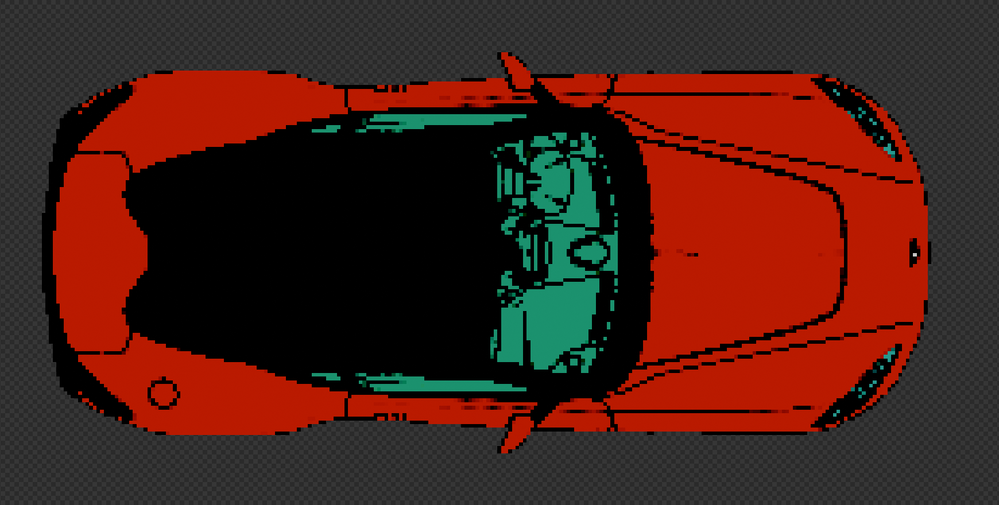
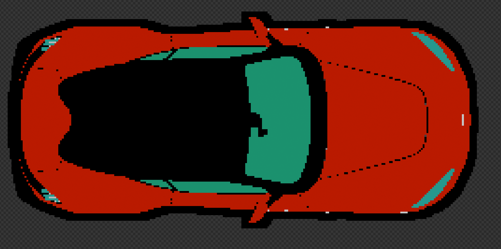

# Sprite Baker

A Blender addon that converts 3D models into pixel art sprites. It prepares the scene (flat colors, no lighting), frames the camera around the model, renders at a higher resolution to obtain a clean outline, downscales the result to the target pixel resolution, posterizes it, and optionally maps every pixel to a fixed color palette.

**Requires Blender 5.0 or newer.**

---

## Table of contents

- [Installation](#installation)
- [Quick start](#quick-start)
- [Panel reference](#panel-reference)
  - [General Options](#general-options)
  - [Render Settings](#render-settings)
  - [Camera Options](#camera-options)
  - [Palette Options](#palette-options)
  - [Rendering](#rendering)

---

## Installation

1. Go to **Edit > Preferences > Add-ons**.
2. Click the down arrow in the top right corner and select **Install from Disk...**
3. Select the `.py` file.
4. Verify that the addon is enabled in the list.

## Quick start

1. Import the model into Blender.
2. In the 3D Viewport, press **N** to open the sidebar and select the **Pixel Art** tab.
3. Click **Apply changes**. If the camera is not framed correctly, click the button again.
4. Adjust the position of the model so that it is centered within the camera borders.
5. To produce the final render:
   1. Set the **Output path**.
   2. Click **Render and save to path**.

---

## Panel reference

### General Options

These parameters rarely need to be modified. They configure the Blender scene itself.

| Option | Description |
|---|---|
| **Convert materials to Emission** | Converts every material to an emission shader (preserving its base color or texture) so that lights no longer affect it. |
| **Disable AO and World** | Disables ambient occlusion and sets the world to black so that it does not contribute any light. |
| **Delete lights** | Removes all lights from the scene. |
| **Center objects at the origin** | Attempts to center the scene objects around the origin. The result is not always exact, so some manual adjustment may be required. This option is disabled automatically after use. |

### Render Settings

#### Render parameter settings

Blender render parameters (**Samples** and **Filter Size**). The default values are sufficient for most cases.

#### Scale

Defines the **final resolution** of the render, in pixels.

#### Posterize

Reduces the number of colors used in the render. The lower the value, the fewer colors remain.

#### Framing

| Option | Description |
|---|---|
| **Frame camera to object** | Adjusts the camera size to fit the borders of the model. |
| **Framing margin** | Amount of padding left between the camera border and the outline of the model. A value of `1` leaves no padding. |
| **Keep aspect ratio** | Computes the Y scale of the render from the camera size and the X scale set in the **Scale** section. This prevents the model from being distorted relative to its original proportions. |

#### Outline

> **Important:** the units in this section are arbitrary. A value of `1` does **not** correspond directly to an outline that is 1 pixel thick. The resulting thickness depends on both the render resolution and the values of these parameters. They should be used as a reference to obtain a thicker or thinner outline.

| Option | Description |
|---|---|
| **General outline size** | Thickness of the outline applied to all the objects of the model. |
| **Silhouette outline size** | Thickness of the outline around the overall shape of the model. |

**Examples**

| General outline: `1` / Silhouette outline: `-10` | General outline: `-10` / Silhouette outline: `10` |
|:---:|:---:|
|  |  |

### Camera Options

Sets the position and rotation of the camera.

The camera **position** and/or **rotation** can be locked using the corresponding toggles, so that they remain unchanged when **Apply changes** is used.

### Palette Options

This menu allows colors to be added, deleted and modified. Palettes can also be imported from and exported to `.txt` files.

The palette file format consists of the hexadecimal colors of the palette, **one per line**. The `#` prefix is optional, and a blank line marks the end of the palette.

```text
#c0c2f6
#99a1cd
#77799f
#4b4c64
#2f2c40
#a0fffb
```

Importing a palette **replaces** the current one. Lines that are not valid hexadecimal colors are ignored and a warning is shown.

### Rendering

| Option | Description |
|---|---|
| **Output path** | Location and file name used when the render button is pressed. The name must end in `.png`. |
| **Render and save to path** | Renders the scene, applies the palette if enabled, and saves the file to the output path. |
| **Apply changes** | Applies the changes made in the addon panel to the scene. |

**Notes on the output path**

- When using a relative path (`//`), save the `.blend` file first so that Blender can resolve it, or use an absolute path instead.
- The destination folder must already exist.
- If a file with the same name already exists, it is **not overwritten**. A numeric suffix is added instead (`_1`, `_2`, ...).
